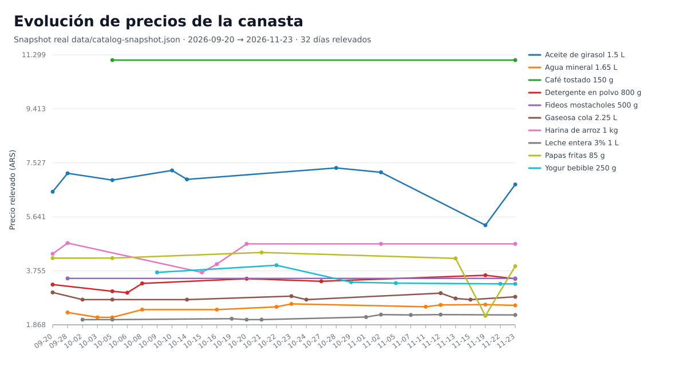

# ofertaSUPER

Comparador de precios y ofertas de 5 supermercados argentinos: Carrefour, Coto,
Disco, Jumbo y Vea. Buscás un producto, ves el precio y la oferta en cada súper
y armás un carrito que puede mezclar súpers.

**En línea en [ofertasuper.com](https://ofertasuper.com)** · más de 25.000 productos y 50.000 ofertas en un catálogo diario · USD 0 de infraestructura

> - **Qué resuelve:** para comparar el mismo producto entre cadenas hace falta una identidad común. Cada observación se concilia por GTIN-14 (con checksum) en un solo catálogo, y un gate de frescura decide qué precio cuenta.
> - **Estado:** en línea; el catálogo se actualiza todos los días con GitHub Actions. No hay datos de uso.
> - **Stack:** TypeScript, Next.js 16, React 19, snapshot JSON versionado al servir; Prisma y PostgreSQL solo en la ingesta y en CI; GitHub Actions.
> - **Cómo correrlo:** `npm ci && npm run dev` (detalle en [Desarrollo local](#desarrollo-local)).
> - **Links:** [sitio](https://ofertasuper.com) · [postmortem del incidente de CPU](docs/postmortem-2026-10-vercel-cpu-pause.md)
> - **Cómo se hizo:** diseño, decido y verifico: defino los tests, los criterios de revisión y las mediciones. Agentes de IA escriben buena parte del código bajo esos tests y esa revisión.

- **Runbook operativo** (actualización diaria, cron, Postgres, backups): [docs/RUNBOOK.md](docs/RUNBOOK.md)
- **Arquitectura** (flujo de datos y módulos clave): [ARCHITECTURE.md](ARCHITECTURE.md)

## Cómo fluyen los datos

Los lectores de catálogo (la API pública VTEX de Carrefour, Disco, Jumbo y Vea, y
la búsqueda que usa el sitio de Coto) escriben el catálogo de cada súper en tablas
de staging de un Postgres local. Un reconcile transaccional con advisory lock
fusiona cada observación en el catálogo vivo (identidad GTIN-14 con checksum), un
gate de frescura decide qué precio cuenta y el pipeline exporta
`data/catalog-snapshot.json`, un snapshot JSON versionado que se commitea en el
repo. Vercel sirve ese snapshot a la app Next.js y a las APIs públicas, sin base
de datos en el camino de lectura; si falta o está corrupto, el sitio muestra "no
disponible", nunca datos de ejemplo. Detalle en [ARCHITECTURE.md](ARCHITECTURE.md).

## Costo por request (Vercel Hobby, USD 0)

El sitio corre en el plan gratuito de Vercel, que incluye 4 horas de CPU activa
por mes. En octubre de 2026 se pasó y quedó pausado 30 días: cada producto
recorría todas las ofertas (productos × ofertas ≈ 1.200 millones de comparaciones,
10-16 s de CPU por request) en el sitemap, `/ofertas` y `/categoria`, sin caché.

El arreglo mantiene el sitio gratis y con la misma salida:

- Índice por EAN armado una vez por proceso: las páginas más pesadas pasaron de
  10-16 s a 18-173 ms de CPU, medido en una réplica local con el snapshot real.
  El sitio volvió el 14/11 con el arreglo; la CPU en producción todavía no está medida.
- Sitemap generado en el build y caché del CDN de Vercel (1 h) en páginas y
  APIs públicas; los errores y los 429 nunca se cachean.
- robots.txt deja afuera a los crawlers de IA, los filtros y la búsqueda interna.
- Un test compara contra el algoritmo anterior y otro cuenta lecturas de
  ofertas: si un camino caliente vuelve a escalar como productos × ofertas, falla.

Detalle, mediciones y decisiones descartadas (Pro, Cloudflare, ISR) en el
[postmortem](docs/postmortem-2026-10-vercel-cpu-pause.md).

## Producto de datos: series diarias e índice de canasta

Un segundo pipeline, independiente del sitio, exporta la serie diaria densa de
precios a Parquet y la modela con DuckDB + dbt (`analytics/`):

<!-- price-chart:start -->


Fuente: snapshot real `data/catalog-snapshot.json` · Rango 2026-09-20 → 2026-11-19 · 27 días relevados.
<!-- price-chart:end -->

- `scripts/export-price-series.ts` escribe una fila por (fecha, GTIN-14, súper)
  desde `price_history` y el estado de cada oferta; un valor con más de 24 h sin
  observarse queda nulo con un motivo explícito.
- El job diario sube un Parquet por día al release `analytics-data`
  (`scripts/analytics-data.sh`). Un índice Laspeyres de canasta fija (12
  productos) se calcula desde toda esa historia y se compara con el IPC del INDEC:
  la serie arranca el 3/10/2026 y `/inflacion` la muestra contra el IPC de
  octubre, con la cobertura del último día relevado.
- La página `/inflacion` renderiza `data/analytics/basket-index.json`
  precalculado: no hay base de datos en el camino de lectura. Mientras la serie
  no tenga al menos dos meses de canasta y un mes de IPC del INDEC superpuesto,
  el JSON publica un estado "datos insuficientes" sin valores y la página lo
  explica; nunca se muestran números de muestra en producción.
- Comandos, modelos, procedencia del IPC y limitaciones: [analytics/README.md](analytics/README.md).

## Desarrollo local

Requisitos: Node 22+, Docker (para el Postgres local).

```bash
npm ci
npx prisma generate
cp .env.example .env.local   # valores locales; las credenciales del bootstrap viven en ~/.config/ofertasuper/postgres.env (nunca se commitean)
docker compose up -d postgres
npm run dev
```

Comandos útiles:

```bash
npm run refresh:catalog   # leer fuentes, actualizar el catálogo y regenerar el snapshot
npm test                  # suite completa
npm run lint              # ESLint
npm run typecheck         # tsc --noEmit
```

La actualización diaria corre sola en la nube con GitHub Actions
(`.github/workflows/daily-refresh.yml`): restaura el estado desde un dump de
Postgres adjunto al release `db-state`, corre el mismo `npm run refresh:catalog`
con sus frenos y commitea el snapshot a `master`. No depende de la PC y no
necesita cuentas ni secretos extra (presupuesto USD 0). El cron local
(`scripts/cron-refresh.sh`) queda como fallback manual, y solo puede haber UN
escritor activo a la vez. El comando exacto, los frenos y la restauración del
Postgres están en [docs/RUNBOOK.md](docs/RUNBOOK.md).

## Limitaciones honestas

- Las promos simples (porcentaje, 2x1, 2do al X %) vienen de Carrefour y Coto; Disco,
  Jumbo y Vea no exponen teasers por producto.
- Las promos bancarias y de fidelidad están fuera de v1.
- La frescura depende del refresh diario: el sitio siempre muestra el último
  snapshot commiteado, con su fecha de observación.
- El índice de canasta de `/inflacion` se recalcula con el refresh diario; su
  JSON declara la fuente, la cobertura y el estado. El ranking de mayores subas
  y bajas no se publica: con el precio relevado hoy, los inicios y finales de
  promos y algunos errores de captura dominan ese ranking.
- Admin: acceso con falla cerrada salvo que la sesión de Clerk tenga el claim exacto de rol admin.

## Documentación histórica

Los planes largos, los specs de governance y los reportes operativos previos
viven en el tag de git `archive/full-governance` (`664674d`). Este repo mantiene
solo los documentos cortos y el runbook vigente.
